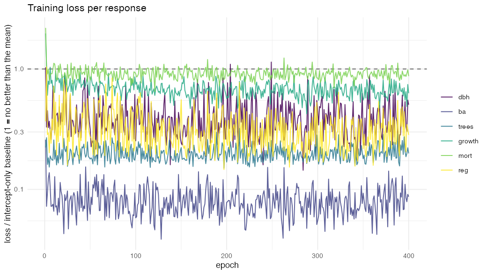
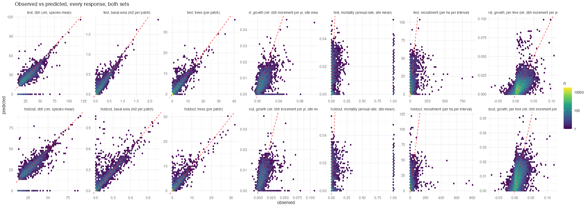
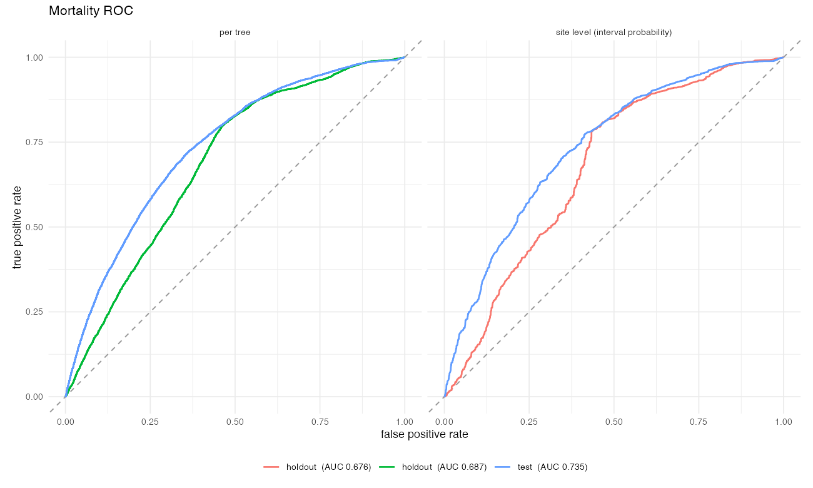
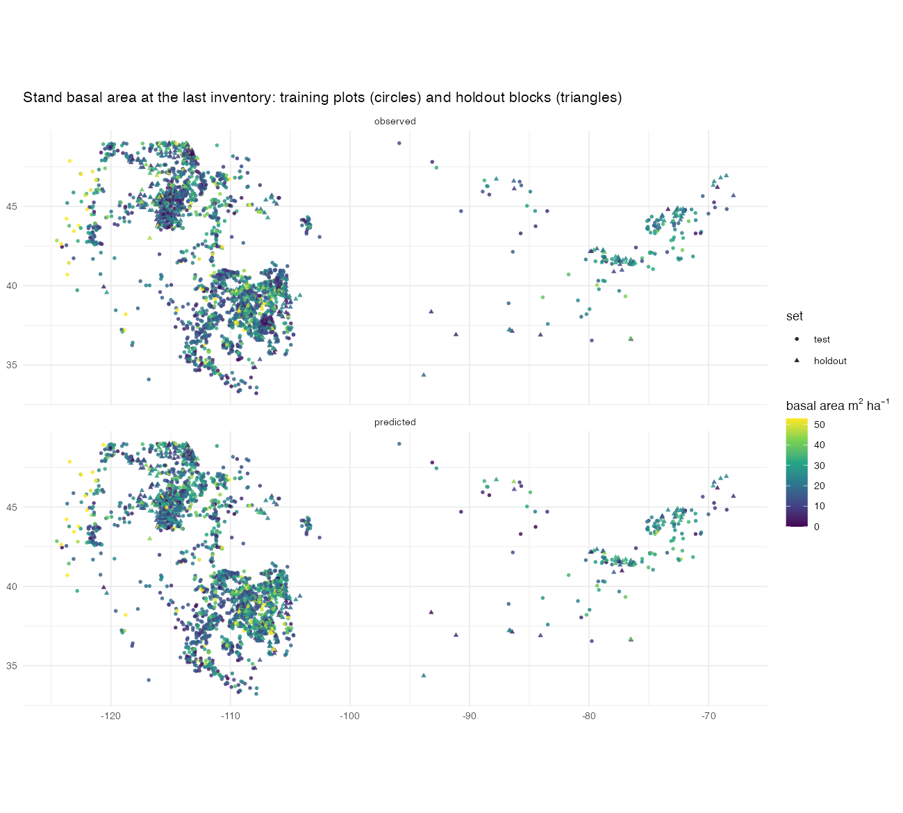
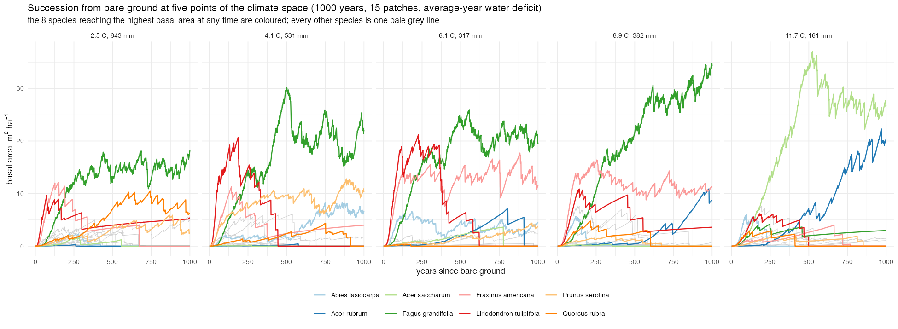
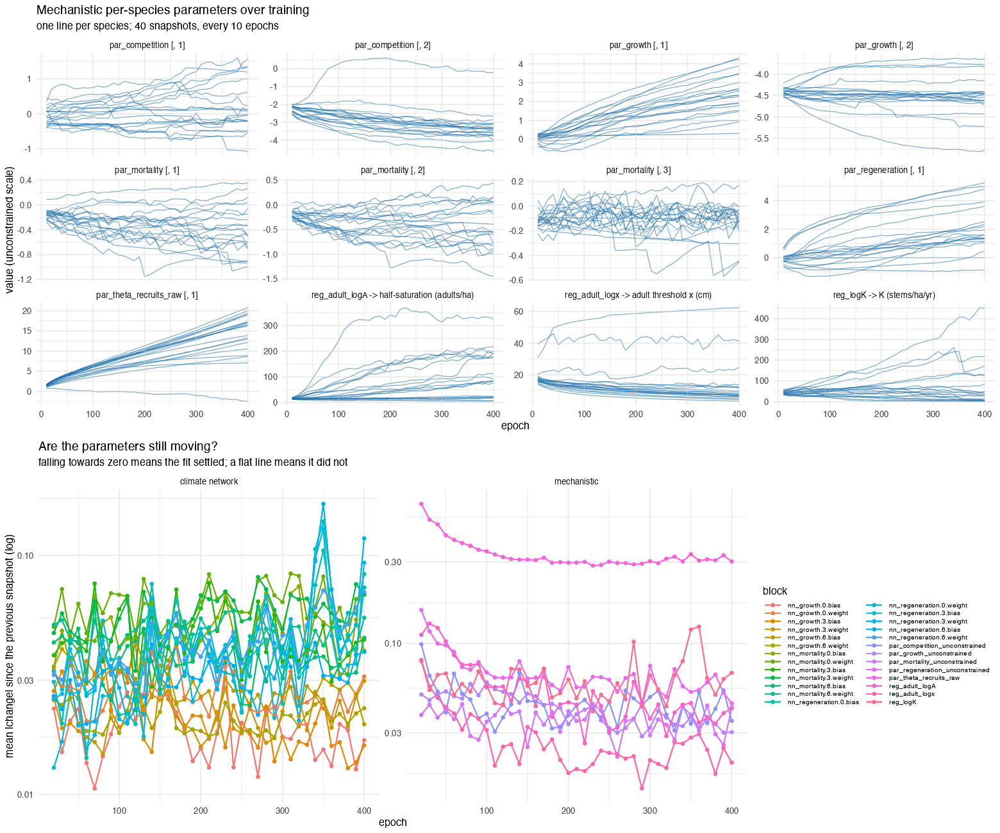

# Validation report: FINN-model-FIA variant `conus`

Generated 2026-11-10 05:56 by `calibration/conus/03_validation.R` (FINN 0.2.0, torch 0.15.1). The model is rebuilt from `parameters.pt` with `build_model()`, as the package does.

Fitted 2026-11-10 05:24 by `calibration/conus/02_fit.R` in 235 min (35.3 s per epoch, 1 thread) on cpu (FINN 0.2.0, torch 0.15.1, R 4.5.0).

Data: `conus-annual-v1/train` (1500 sites, 20 species, annual step, per-site intervals, 47892 tree intervals). Holdout for validation: `holdout`.

Processes: FINN::growth, FINN::mortality, FINN::regeneration_adult (inits K 50 stems/ha/yr, adult threshold 20 cm, half-saturation 15 adults/ha), FINN::competition; climate network hidden = c(20, 20), dropout 0.1, on `~tavg_c + prec_mm + cwd_z`; reg_floor 0.001; recruits_dbh 12.9; 4 patches of 0.01681 ha.

Fit: 400 epochs, batch 100, lr 0.01, weights "auto" with weight_scale "auto" (baseline-scaled losses), loss families dbh = mse, ba = mse, trees = poisson, growth = mse, mortality = binomial, regeneration = nbinom, growth and mortality aggregated per tree, env_autoscale TRUE, seed 1.

Final losses (baseline-scaled, 1 = no better than the mean): dbh 0.505, ba 0.087, trees 0.199, growth 0.629, mort 0.873, reg 0.283.

Fitted adult threshold x: min 3.3, median 7.8, max 62.4 cm. Half-saturation: min 5.6, median 84.6, max 325.3 adults/ha. Caps K: median 31.6 stems/ha/yr (adult_parameters.csv).

Environment scaling stored with the model: tavg_c (center 6.709, scale 3.634); prec_mm (center 478.305, scale 318.727); cwd_z (center 0.380, scale 0.936).

parameters.pt: 26 parameter tensors (nn_mortality.0.weight, nn_mortality.0.bias, nn_mortality.3.weight, nn_mortality.3.bias, nn_mortality.6.weight, nn_mortality.6.bias, nn_growth.0.weight, nn_growth.0.bias, nn_growth.3.weight, nn_growth.3.bias, nn_growth.6.weight, nn_growth.6.bias, nn_regeneration.0.weight, nn_regeneration.0.bias, nn_regeneration.3.weight, nn_regeneration.3.bias, nn_regeneration.6.weight, nn_regeneration.6.bias, par_mortality_unconstrained, par_growth_unconstrained, reg_logK, reg_adult_logx, reg_adult_logA, par_regeneration_unconstrained, par_theta_recruits_raw, par_competition_unconstrained); sha256 d40ce38f94bc307fd17fc172cf12d8c29f5b95415eb08e711d1f1a2838f2a9a9. build_model() reproduces the fitted simulation (max |diff| 0).

Validation report: `Rscript calibration/conus/03_validation.R`.

## The two sets

- **test**: the 1500 plots the model was fitted on (`conus-annual-v1/train`).
- **holdout**: 1000 plots in 2-degree blocks that hold no training plot (`conus-annual-v1/holdout`), never used in fitting. Distance to the nearest training plot: median 50 km, minimum 4 km, 10 % below 19 km.

Each set is simulated from its own first inventory over its whole span (annual steps). The annual predictions are aggregated over every observed remeasurement interval as `fit()` scores them: states at the census year, growth and mortality as the mean annual rate, recruitment as the sum. Per-tree growth and mortality: `FINN::predictTrees` on the observed stands.

## Pooled metrics (all species x plots x intervals)

| set | variable | n | rmse | r2 | r | bias | obs_mean | auc |
|---|---|---|---|---|---|---|---|---|
| test | dbh (cm, species mean) |  3830 |  6.62000 |  0.5910 | 0.818 | -1.70e+00 | 27.00000 | NA |
| test | basal area (m2 per patch) | 36700 |  0.02240 |  0.9210 | 0.961 |  6.18e-04 |  0.01820 | NA |
| test | trees (per patch) | 36700 |  0.47700 |  0.8830 | 0.943 |  1.18e-02 |  0.31100 | NA |
| test | growth (rel. dbh increment per yr, site mean) |  3680 |  0.00771 |  0.2180 | 0.536 | -2.28e-03 |  0.00947 | NA |
| test | mortality (annual rate, site mean) |  3790 |  0.15200 | -0.0112 | 0.182 | -2.66e-02 |  0.03730 | 0.735 |
| test | recruitment (per ha per interval) | 36700 | 13.30000 |  0.2290 | 0.492 | -5.52e-01 |  1.95000 | NA |
| holdout | dbh (cm, species mean) |  2490 |  6.99000 |  0.5530 | 0.792 | -1.38e+00 | 27.30000 | NA |
| holdout | basal area (m2 per patch) | 23200 |  0.03080 |  0.8200 | 0.919 |  2.01e-03 |  0.01720 | NA |
| holdout | trees (per patch) | 23200 |  0.53700 |  0.8310 | 0.922 |  3.51e-02 |  0.28800 | NA |
| holdout | growth (rel. dbh increment per yr, site mean) |  2390 |  0.00810 |  0.1490 | 0.436 | -1.72e-03 |  0.00886 | NA |
| holdout | mortality (annual rate, site mean) |  2510 |  0.19700 | -0.0422 | 0.182 | -4.62e-02 |  0.05650 | 0.676 |
| holdout | recruitment (per ha per interval) | 23200 | 13.80000 |  0.1280 | 0.362 | -1.88e-01 |  1.68000 | NA |
| test | growth, per tree (rel. dbh increment per yr) | 40400 |  0.00685 |  0.2970 | 0.564 | -6.04e-05 |  0.00738 | NA |
| test | mortality, per tree (died over the interval) | 47900 |  0.34200 |  0.0828 | 0.299 | -2.82e-02 |  0.15000 | 0.735 |
| holdout | growth, per tree (rel. dbh increment per yr) | 23800 |  0.00704 |  0.2650 | 0.521 |  2.68e-04 |  0.00678 | NA |
| holdout | mortality, per tree (died over the interval) | 29500 |  0.37800 |  0.0301 | 0.241 | -6.41e-02 |  0.17900 | 0.687 |

## Stand totals (summed over species per plot and census)

| set | variable | n | rmse | r2 | r | bias | obs_mean |
|---|---|---|---|---|---|---|---|
| test | basal area (m2 per patch) | 1840 |  0.103 |  0.7680 | 0.883 |   0.0124 |  0.364 |
| test | trees (per patch) | 1840 |  2.220 |  0.6970 | 0.853 |   0.2370 |  6.220 |
| test | recruitment (per ha per interval) | 1840 | 64.700 |  0.0508 | 0.283 | -11.0000 | 39.000 |
| holdout | basal area (m2 per patch) | 1160 |  0.148 |  0.4830 | 0.761 |   0.0401 |  0.345 |
| holdout | trees (per patch) | 1160 |  2.620 |  0.6190 | 0.825 |   0.7020 |  5.750 |
| holdout | recruitment (per ha per interval) | 1160 | 70.300 | -0.0126 | 0.149 |  -3.7500 | 33.600 |

## Model against persistence

Persistence = the first inventory carried forward unchanged. FINN forecasts from that same inventory, so for the state variables what counts is what it adds beyond "nothing changes".

| set | level | variable | r2_model | rmse_model | spearman_model | r2_persistence | rmse_persistence | spearman_persistence |
|---|---|---|---|---|---|---|---|---|
| holdout | species x plot | basal area (m2 per patch) | 0.820 | 0.0308 | 0.947 | 0.820 | 0.0308 | 0.949 |
| holdout | species x plot | dbh (cm, species mean) | 0.553 | 6.9900 | 0.849 | 0.805 | 4.5900 | 0.888 |
| holdout | species x plot | trees (per patch) | 0.831 | 0.5370 | 0.946 | 0.828 | 0.5400 | 0.948 |
| holdout | stand total | basal area (m2 per patch) | 0.483 | 0.1480 | 0.770 | 0.482 | 0.1480 | 0.768 |
| holdout | stand total | trees (per patch) | 0.619 | 2.6200 | 0.765 | 0.612 | 2.6500 | 0.770 |
| test | species x plot | basal area (m2 per patch) | 0.921 | 0.0224 | 0.962 | 0.920 | 0.0226 | 0.966 |
| test | species x plot | dbh (cm, species mean) | 0.591 | 6.6200 | 0.867 | 0.821 | 4.3500 | 0.898 |
| test | species x plot | trees (per patch) | 0.883 | 0.4770 | 0.961 | 0.869 | 0.5060 | 0.965 |
| test | stand total | basal area (m2 per patch) | 0.768 | 0.1030 | 0.858 | 0.762 | 0.1040 | 0.849 |
| test | stand total | trees (per patch) | 0.697 | 2.2200 | 0.833 | 0.665 | 2.3300 | 0.838 |

## Mortality AUC

| set | n_trees_at_risk | n_died | auc_site_level | auc_per_tree |
|---|---|---|---|---|
| test | 47900 | 7180 | 0.735 | 0.735 |
| holdout | 29400 | 5270 | 0.676 | 0.687 |

## Holdout, per species

R2, RMSE and Spearman of basal area and stem number per patch, the per-tree mortality AUC, per-tree growth R2 and recruitment Spearman, each within the species.

| species | r2_ba | r2_trees | rmse_ba | rmse_trees | spearman_ba | spearman_trees | mort_auc_tree | growth_r2_tree | reg_spearman | r2_ba_persistence |
|---|---|---|---|---|---|---|---|---|---|---|
| Quercus alba |  0.990 | 0.983 | 0.001730 | 0.0243 | 1.000 | 1.000 | 0.258 | -0.1920 |  0.12700 |  0.9660 |
| Juniperus osteosperma |  0.979 | 0.975 | 0.023500 | 0.2400 | 0.990 | 0.990 | 0.499 |  0.0652 |  0.40700 |  0.9880 |
| Acer saccharum |  0.965 | 0.964 | 0.015100 | 0.2270 | 0.984 | 0.984 | 0.605 |  0.1110 |  0.42700 |  0.9650 |
| Prunus serotina |  0.957 | 0.835 | 0.004220 | 0.1030 | 0.875 | 0.870 | 0.584 |  0.4790 |  0.00203 |  0.9360 |
| Quercus rubra |  0.955 | 0.983 | 0.006900 | 0.0446 | 0.760 | 0.758 | 0.432 | -2.1400 | -0.11700 |  0.9430 |
| Pinus ponderosa |  0.952 | 0.957 | 0.020400 | 0.2630 | 0.978 | 0.978 | 0.543 |  0.2250 |  0.42600 |  0.9580 |
| Pinus edulis |  0.945 | 0.921 | 0.014500 | 0.3310 | 0.980 | 0.979 | 0.460 |  0.1890 |  0.45700 |  0.9480 |
| Nyssa sylvatica |  0.933 | 0.791 | 0.005300 | 0.2030 | 0.955 | 0.955 | 0.705 | -0.6580 |  0.08450 |  0.9310 |
| Betula alleghaniensis |  0.925 | 0.837 | 0.004490 | 0.0908 | 0.914 | 0.908 | 0.580 |  0.2590 |  0.02980 |  0.9560 |
| Acer rubrum |  0.909 | 0.780 | 0.015100 | 0.4250 | 0.958 | 0.957 | 0.632 |  0.0851 |  0.38200 |  0.9160 |
| Populus tremuloides |  0.895 | 0.872 | 0.022300 | 0.6230 | 0.923 | 0.923 | 0.622 | -0.1790 |  0.34500 |  0.9050 |
| Pseudotsuga menziesii |  0.831 | 0.880 | 0.044000 | 0.5780 | 0.970 | 0.969 | 0.530 |  0.3850 |  0.45100 |  0.8250 |
| Fraxinus americana |  0.809 | 0.792 | 0.009360 | 0.1740 | 0.882 | 0.884 | 0.666 | -0.1400 |  0.14500 |  0.9120 |
| Liriodendron tulipifera |  0.803 | 0.683 | 0.004960 | 0.0696 | 0.817 | 0.817 | 0.935 | -0.1570 |  0.11000 |  0.7030 |
| Pinus contorta |  0.778 | 0.883 | 0.050000 | 1.1700 | 0.954 | 0.956 | 0.555 |  0.0710 |  0.53000 |  0.7470 |
| Abies lasiocarpa |  0.696 | 0.694 | 0.040900 | 0.9730 | 0.860 | 0.863 | 0.555 |  0.0455 |  0.54800 |  0.7230 |
| Fagus grandifolia |  0.673 | 0.799 | 0.019900 | 0.3740 | 0.973 | 0.974 | 0.652 |  0.0844 |  0.48500 |  0.8310 |
| Ulmus americana |  0.585 | 0.822 | 0.000997 | 0.0275 | 0.708 | 0.708 | 0.631 | -0.9310 | -0.12100 |  0.6620 |
| Picea engelmannii |  0.217 | 0.308 | 0.101000 | 1.4200 | 0.940 | 0.939 | 0.504 |  0.2430 |  0.52600 |  0.1990 |
| Quercus velutina | -0.070 | 0.235 | 0.003560 | 0.1220 | 0.331 | 0.333 | NA | -0.5220 | -0.12800 | -0.0728 |

## Succession from bare ground

Five climate points (10/30/50/70/90 % quantile of plot mean temperature, with that plot's precipitation), cwd_z = 0 (average-year water deficit), 1000 years, 15 patches. Stand basal area (m2/ha) averaged over the last 10 % of the run against the 10 % before, and the number of species above 1 m2/ha.

| loc | ba_last | ba_prev | drift_pct | trees_last | n_species_above_1 |
|---|---|---|---|---|---|
| 2.5 C, 643 mm | 35.9 | 35.2 |   1.970 | 362 | 5 |
| 4.1 C, 531 mm | 43.4 | 43.7 |  -0.751 | 596 | 6 |
| 6.1 C, 317 mm | 44.1 | 49.2 | -10.300 | 506 | 6 |
| 8.9 C, 382 mm | 56.4 | 51.1 |  10.500 | 426 | 4 |
| 11.7 C, 161 mm | 51.0 | 48.2 |   5.810 | 323 | 5 |

Verdict: CHECK: at least one climate point drifts, collapses or runs away (see the table); the model is not validated as an equilibrium model there.

## Figures

## Provenance

| step | script | inputs | outputs |
|---|---|---|---|
| FIA raw | USDA FS FIA DataMart, CSV dump (June 2025) | - | ENTIRE_TREE/PLOT/COND/SUBPLOT csv |
| climate | FINN-fia scripts/03c, 03d (TerraClimate yearly per plot) | TerraClimate 1958-2023 | annual_climate_by_plot.csv |
| cohort + FINN tables | FINN-fia scripts/01, 02, extract_trees, 03, 07b, 07 (commit 58fcf3e, 2026-09-10) | FIADB csv, climate | outputs/prepared/annual-v5 |
| preparation | calibration/conus/01_prepare.R | annual-v5 train1500, holdout_blocked | prepared/conus-annual-v1/{train,holdout}, PREPARATION.md, expected_preparation.csv |
| fit | calibration/conus/02_fit.R | prepared/conus-annual-v1/train | fits/conus/parameters.pt, model.pt, loss_history.csv, fit_summary.md, env_scaling.csv, adult_parameters.csv |
| validation | calibration/conus/03_validation.R | parameters.pt, prepared/conus-annual-v1/{train,holdout} | this report, metrics.csv, validation/ |
