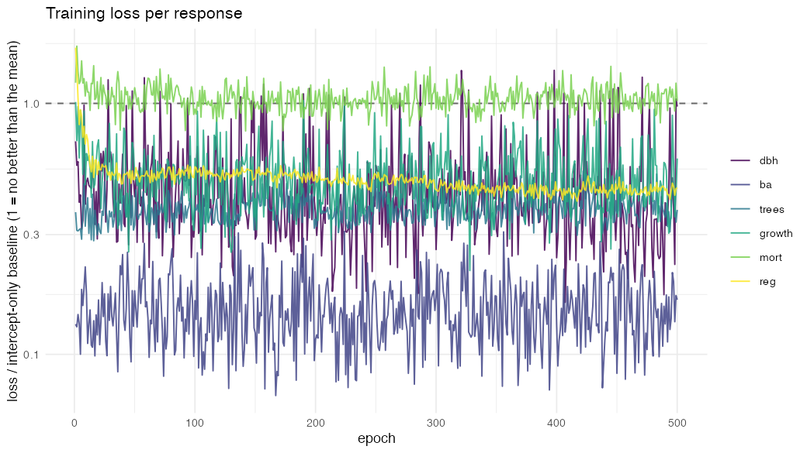
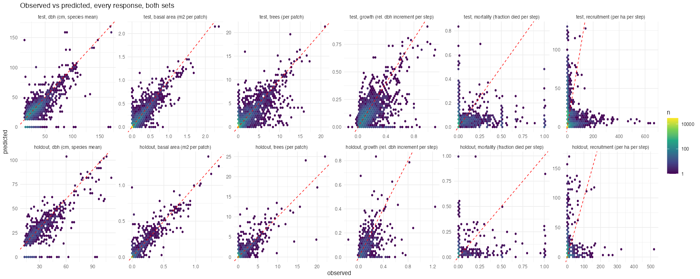
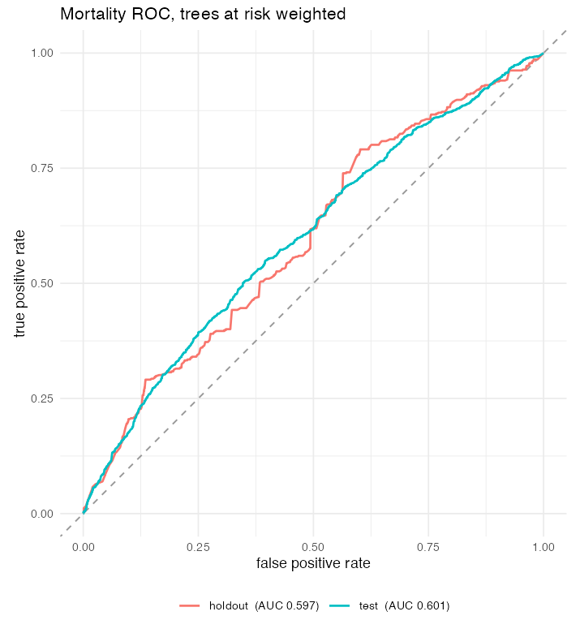
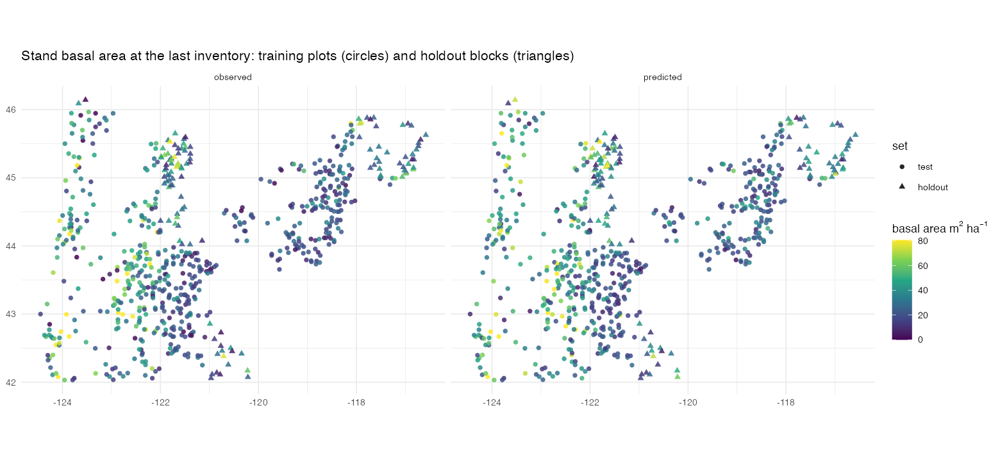
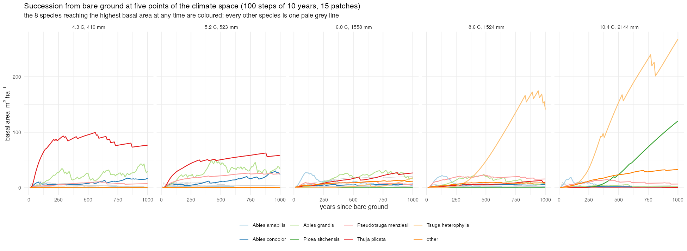
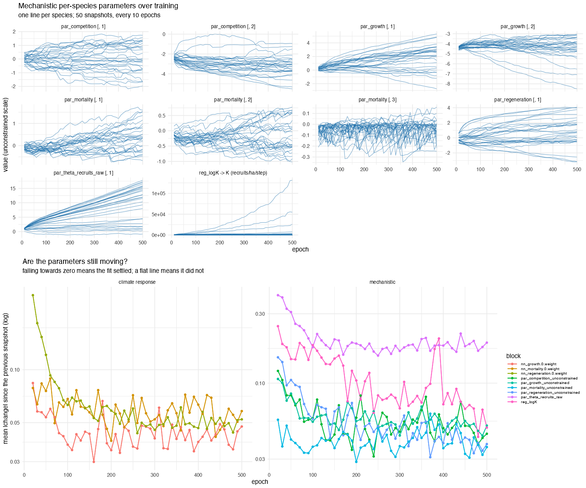

# Validation report: FINN-model-FIA variant `oregon`

Generated 2026-11-10 05:54 by `calibration/oregon/03_validation.R` (FINN 0.2.0, torch 0.15.1). The model is rebuilt from `parameters.pt` with `build_model()`, as the package does.

Fitted 2026-11-10 01:47 by `calibration/oregon/02_fit.R` in 18 min (2.2 s per epoch, 1 thread) on cpu (FINN 0.2.0, torch 0.15.1, R 4.5.0).

Data: `oregon-10yr-v1/train_blocked` (590 sites, 28 species incl. other, 2 census steps of 10 years). Holdout for validation: `holdout_blocked`.

Processes: FINN::growth, FINN::mortality, FINN::regeneration_saturation (K init 500), FINN::competition; climate `~temp + prec` linear per species (hidden = NULL); reg_floor 0.01; recruits_dbh 12.9; 4 patches of 0.01681 ha.

Fit: 500 epochs, batch 50, lr 0.01, weights "auto" with weight_scale "auto" (baseline-scaled losses), loss families dbh = mse, ba = mse, trees = poisson, growth = mse, mortality = binomial, regeneration = nbinom, env_autoscale TRUE, seed 42.

Final losses (baseline-scaled, 1 = no better than the mean): dbh 0.972, ba 0.165, trees 0.376, growth 0.603, mort 1.023, reg 0.462.

Fitted recruitment caps K (stems per ha per decade): min 0.0, median 37.9, max 131271.7.

Environment scaling stored with the model: temp (center 6.872, scale 2.445); prec (center 1078.080, scale 673.151).

parameters.pt: 9 parameter tensors (nn_mortality.0.weight, nn_growth.0.weight, nn_regeneration.0.weight, par_mortality_unconstrained, par_growth_unconstrained, reg_logK, par_regeneration_unconstrained, par_theta_recruits_raw, par_competition_unconstrained); sha256 0d29d459a7ae10e692550c1ce64d9a94d42d8f03b7a971108ae12c57af32d815. build_model() reproduces the fitted simulation (max |diff| 0).

Validation report: `Rscript calibration/oregon/03_validation.R`.

## The two sets

- **test**: the 590 plots the model was fitted on (`oregon-10yr-v1/train_blocked`).
- **holdout**: 118 plots in 1-degree blocks that hold no training plot (`oregon-10yr-v1/holdout_blocked`), never used in fitting. Distance to the nearest training plot: median 30 km, minimum 3 km, 10 % below 14 km.

Each set is simulated from its own first inventory over two 10-year steps; the state at a step is compared with the inventory of that step, the per-step rates with the observed rates of the interval that ends there.

## Pooled metrics (all species x plots x steps)

| set | variable | n | rmse | r2 | r | bias | obs_mean | auc |
|---|---|---|---|---|---|---|---|---|
| test | dbh (cm, species mean) |  3320 | 11.7000 |  0.5220 | 0.7810 | -2.94000 | 30.9000 | NA |
| test | basal area (m2 per patch) | 33000 |  0.0338 |  0.8520 | 0.9240 |  0.00045 |  0.0175 | NA |
| test | trees (per patch) | 33000 |  0.5680 |  0.6880 | 0.8380 |  0.05570 |  0.2170 | NA |
| test | growth (rel. dbh increment per step) |  3090 |  0.1140 |  0.2690 | 0.5980 | -0.03190 |  0.1460 | NA |
| test | mortality (fraction died per step) |  3090 |  0.1720 | -0.0584 | 0.1230 | -0.01700 |  0.0661 | 0.601 |
| test | recruitment (per ha per step) | 33000 | 18.2000 | -0.1840 | 0.0818 |  1.13000 |  2.2000 | NA |
| holdout | dbh (cm, species mean) |   747 | 12.3000 |  0.5000 | 0.7760 | -3.94000 | 32.6000 | NA |
| holdout | basal area (m2 per patch) |  6610 |  0.0328 |  0.8590 | 0.9290 |  0.00117 |  0.0190 | NA |
| holdout | trees (per patch) |  6610 |  0.6010 |  0.6800 | 0.8490 |  0.07060 |  0.2260 | NA |
| holdout | growth (rel. dbh increment per step) |   695 |  0.1330 | -0.0318 | 0.4220 | -0.03930 |  0.1400 | NA |
| holdout | mortality (fraction died per step) |   702 |  0.2120 | -0.1740 | 0.1320 | -0.02170 |  0.0831 | 0.597 |
| holdout | recruitment (per ha per step) |  6610 | 17.4000 | -0.4140 | 0.1650 |  1.68000 |  2.1900 | NA |

## Stand totals (summed over species per plot and step)

| set | variable | n | rmse | r2 | r | bias | obs_mean |
|---|---|---|---|---|---|---|---|
| test | basal area (m2 per patch) | 1180 |  0.185 |  0.6760 | 0.834 |  0.0126 |  0.489 |
| test | trees (per patch) | 1180 |  3.460 |  0.0321 | 0.609 |  1.5600 |  6.080 |
| test | recruitment (per ha per step) | 1180 | 95.800 | -0.1790 | 0.141 | 31.7000 | 61.600 |
| holdout | basal area (m2 per patch) |  236 |  0.179 |  0.6890 | 0.846 |  0.0328 |  0.532 |
| holdout | trees (per patch) |  236 |  3.680 |  0.2110 | 0.758 |  1.9800 |  6.320 |
| holdout | recruitment (per ha per step) |  236 | 99.600 | -0.7730 | 0.164 | 47.1000 | 61.300 |

## Model against persistence

Persistence = the first inventory carried forward unchanged. FINN forecasts from that same inventory, so for the state variables what counts is what it adds beyond "nothing changes".

| set | level | variable | r2_model | rmse_model | spearman_model | r2_persistence | rmse_persistence | spearman_persistence |
|---|---|---|---|---|---|---|---|---|
| holdout | species x plot | basal area (m2 per patch) | 0.8590 |  0.0328 | 0.672 | 0.865 | 0.0321 | 0.915 |
| holdout | species x plot | dbh (cm, species mean) | 0.5000 | 12.3000 | 0.740 | 0.731 | 9.0000 | 0.807 |
| holdout | species x plot | trees (per patch) | 0.6800 |  0.6010 | 0.645 | 0.770 | 0.5100 | 0.913 |
| holdout | stand total | basal area (m2 per patch) | 0.6890 |  0.1790 | 0.831 | 0.683 | 0.1810 | 0.811 |
| holdout | stand total | trees (per patch) | 0.2110 |  3.6800 | 0.699 | 0.531 | 2.8400 | 0.714 |
| test | species x plot | basal area (m2 per patch) | 0.8520 |  0.0338 | 0.648 | 0.834 | 0.0359 | 0.896 |
| test | species x plot | dbh (cm, species mean) | 0.5220 | 11.7000 | 0.784 | 0.727 | 8.8300 | 0.836 |
| test | species x plot | trees (per patch) | 0.6880 |  0.5680 | 0.621 | 0.756 | 0.5020 | 0.893 |
| test | stand total | basal area (m2 per patch) | 0.6760 |  0.1850 | 0.797 | 0.601 | 0.2060 | 0.757 |
| test | stand total | trees (per patch) | 0.0321 |  3.4600 | 0.598 | 0.284 | 2.9800 | 0.630 |

## Mortality AUC (trees at risk weighted)

| set | n_trees_at_risk | n_died | auc |
|---|---|---|---|
| test | 24600 | 1720 | 0.601 |
| holdout |  5330 |  502 | 0.597 |

## Holdout, per species

R2, RMSE and Spearman of basal area and stem number per patch, the per-tree mortality AUC, growth R2 and recruitment Spearman, each within the species.

| species | r2_ba | r2_trees | rmse_ba | rmse_trees | spearman_ba | spearman_trees | mort_auc | growth_r2 | reg_spearman | r2_ba_persistence |
|---|---|---|---|---|---|---|---|---|---|---|
| Juniperus occidentalis |   0.99200 |   0.91300 | 0.001210 | 0.0488 | 0.662 | 0.661 | NA |   0.6170 | 0.1500 |  0.98800 |
| Larix occidentalis |   0.97600 |   0.94300 | 0.013500 | 0.1360 | 0.898 | 0.885 | 0.777 |   0.6120 | 0.1140 |  0.96700 |
| Abies concolor |   0.95500 |   0.82500 | 0.031100 | 0.7090 | 0.485 | 0.460 | 0.615 |  -0.2380 | 0.1820 |  0.88300 |
| Calocedrus decurrens |   0.92200 |   0.80000 | 0.001790 | 0.0746 | 0.588 | 0.588 | NA |  -1.0800 | 0.0675 |  0.81000 |
| Abies lasiocarpa |   0.89400 |   0.79900 | 0.014200 | 0.4850 | 0.705 | 0.692 | 0.502 |   0.2680 | 0.3610 |  0.90700 |
| Abies grandis |   0.88600 |   0.71700 | 0.051700 | 0.7360 | 0.704 | 0.659 | 0.408 |  -0.5260 | 0.0950 |  0.81400 |
| Pinus ponderosa |   0.88400 |   0.81500 | 0.054400 | 0.6370 | 0.921 | 0.911 | 0.436 |  -0.1780 | 0.3850 |  0.89400 |
| Abies amabilis |   0.88200 |   0.56600 | 0.039800 | 1.4700 | 0.686 | 0.649 | 0.639 |  -0.1660 | 0.4680 |  0.96300 |
| Tsuga mertensiana |   0.88000 |   0.89400 | 0.027400 | 0.4670 | 0.734 | 0.725 | 0.791 |  -0.1460 | 0.3110 |  0.87300 |
| Pseudotsuga menziesii |   0.85700 |   0.76300 | 0.075100 | 0.8900 | 0.905 | 0.877 | 0.511 |   0.1870 | 0.2610 |  0.85800 |
| Tsuga heterophylla |   0.81500 |   0.60200 | 0.077900 | 0.9720 | 0.840 | 0.825 | 0.534 |  -0.1530 | 0.4730 |  0.90200 |
| Picea engelmannii |   0.76300 |   0.67500 | 0.021500 | 0.2550 | 0.869 | 0.865 | 0.436 |  -0.5870 | 0.3470 |  0.90800 |
| Alnus rubra |   0.67500 |   0.71400 | 0.004130 | 0.1090 | 1.000 | 1.000 | NA |   0.1150 | 0.1530 |  0.36700 |
| Quercus garryana |   0.49800 |   0.48800 | 0.005050 | 0.2600 | 0.896 | 0.896 | NA | -21.6000 | 0.2010 |  0.53600 |
| Acer macrophyllum |   0.46800 |   0.34100 | 0.001720 | 0.0587 | 0.860 | 0.862 | NA |  -5.3100 | 0.1020 |  0.82400 |
| Thuja plicata |   0.45800 |   0.84200 | 0.012100 | 0.0609 | 0.900 | 0.891 | 0.613 |   0.1500 | 0.1850 |  0.50700 |
| Pinus monticola |   0.34700 |   0.02510 | 0.010700 | 0.3330 | 0.614 | 0.662 | 0.737 |  -1.2500 | 0.2490 |  0.15900 |
| Abies procera |   0.10400 |  -1.35000 | 0.018700 | 0.3510 | 0.464 | 0.452 | 0.823 |  -2.4400 | 0.2040 |  0.14000 |
| Picea sitchensis |  -0.00426 |  -0.00426 | 0.003460 | 0.1140 | NA | NA | NA | NA | 0.1120 | -0.00426 |
| Pinus contorta |  -0.21600 |   0.50800 | 0.088700 | 1.8100 | 0.779 | 0.750 | 0.490 |  -0.0405 | 0.3150 | -0.20200 |
| other | -10.80000 | -67.80000 | 0.011000 | 0.7610 | 0.169 | 0.116 | 0.372 |   0.1140 | 0.0556 | -2.33000 |
| Abies shastensis | NA | NA | 0.001780 | 0.1200 | NA | NA | NA | NA | NA | NA |
| Arbutus menziesii | NA | NA | 0.000213 | 0.0163 | NA | NA | NA | NA | NA | NA |
| Chrysolepis chrysophylla var. chrysophylla | NA | NA | 0.000705 | 0.0515 | NA | NA | NA | NA | NA | NA |
| Lithocarpus densiflorus | NA | NA | 0.000000 | 0.0000 | NA | NA | NA | NA | NA | NA |
| Pinus lambertiana | NA | NA | 0.000502 | 0.0364 | NA | NA | NA | NA | NA | NA |
| Quercus chrysolepis | NA | NA | 0.000000 | 0.0000 | NA | NA | NA | NA | NA | NA |
| Quercus kelloggii | NA | NA | 0.000000 | 0.0000 | NA | NA | NA | NA | NA | NA |

## Succession from bare ground

Five climate points (10/30/50/70/90 % quantile of plot temperature), 100 steps of 10 years, 15 patches. Stand basal area (m2/ha) averaged over the last 10 % of the run against the 10 % before, and the number of species above 1 m2/ha.

| loc | ba_last | ba_prev | drift_pct | trees_last | n_species_above_1 |
|---|---|---|---|---|---|
| 4.3 C, 410 mm | 144 | 136 |  5.370 |  752 |  8 |
| 5.2 C, 523 mm | 153 | 144 |  6.470 | 1050 |  6 |
| 6.0 C, 1558 mm | 118 | 117 |  0.629 | 1290 | 11 |
| 8.6 C, 1524 mm | 223 | 225 | -1.030 | 1010 | 10 |
| 10.4 C, 2144 mm | 415 | 365 | 13.800 | 1020 | 10 |

Verdict: CHECK: at least one climate point drifts, collapses or runs away (see the table); the model is not validated as an equilibrium model there.

## Figures

## Provenance

| step | script | inputs | outputs |
|---|---|---|---|
| FIA raw | USDA FS FIA DataMart, CSV dump (June 2025) | - | ENTIRE_TREE/PLOT/COND/SUBPLOT csv |
| Oregon export | FINN-fia scripts/01-03, 07 (2026-06; FINN commit 15922a1 data-raw) | FIADB csv, WorldClim 2.1 | full_tree_dt.csv, env_unscaled_dt.csv, species_dt.csv |
| coordinates | calibration/oregon/01_prepare.R | FIADB ENTIRE_PLOT.csv | oregon_plot_coords.csv |
| preparation | calibration/oregon/01_prepare.R | the export + coordinates | prepared/oregon-10yr-v1/{all,train_blocked,holdout_blocked}, PREPARATION.md, expected_preparation.csv |
| fit | calibration/oregon/02_fit.R | prepared/oregon-10yr-v1/train_blocked | fits/oregon/parameters.pt, model.pt, loss_history.csv, fit_summary.md, env_scaling.csv |
| validation | calibration/oregon/03_validation.R | parameters.pt, prepared/oregon-10yr-v1/{train_blocked,holdout_blocked} | this report, metrics.csv, validation/ |
